# ELIOS

ELIOS is a waste-sorting robot and learning app for physics and environmental
education. A student points a camera at a waste item. ELIOS names the item,
picks its bin (organik, anorganik, B3 hazardous, or residu), and gives a short
quiz about it. With the robot, the arm then carries the item to the right bin.

The camera can be the phone's own camera or the **MaixCAM2** on the robot. The
AI is **Google Gemini**, called through a small backend so the API key never
ships in the app.

### Phone app

<p align="center">
  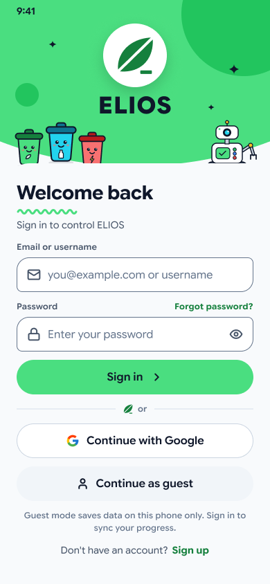
  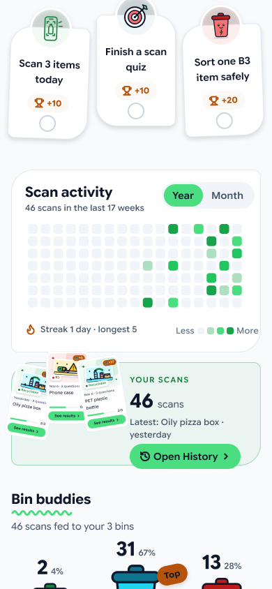
  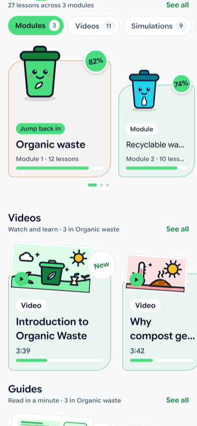
  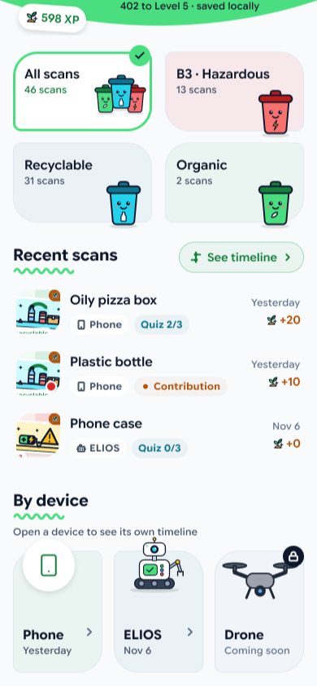
  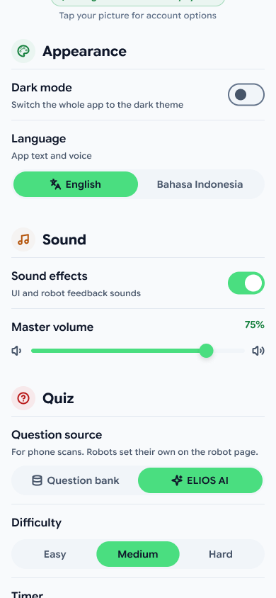
</p>

### Scan and quiz with the phone

<p align="center">
  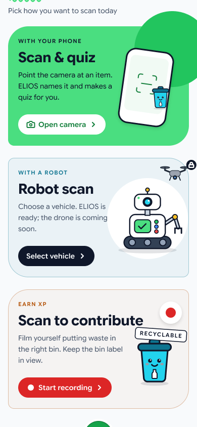
  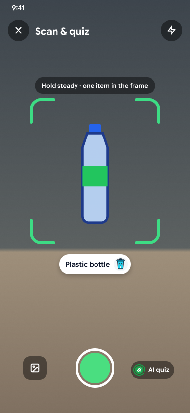
  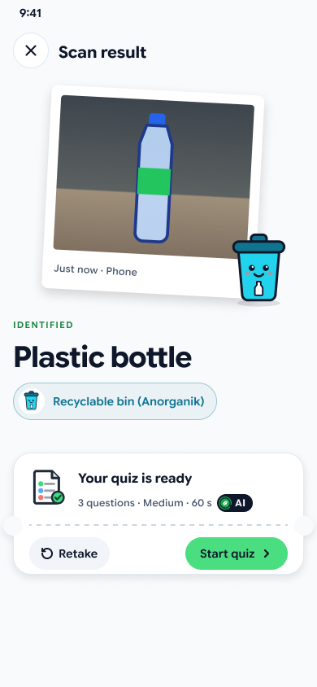
  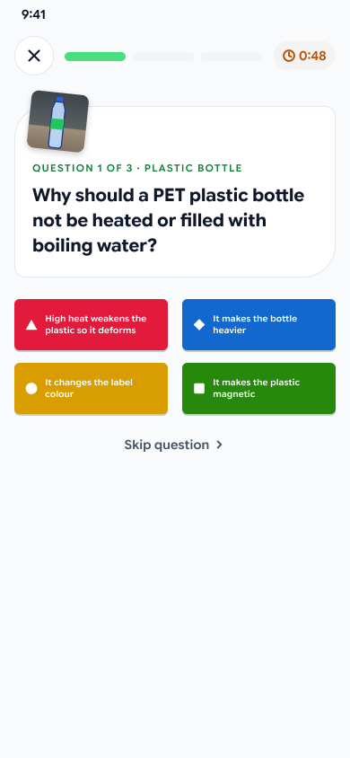
  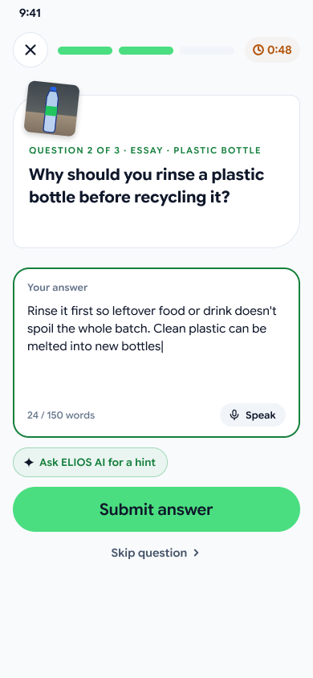
</p>

### Robot control (phone landscape)

<p align="center">
  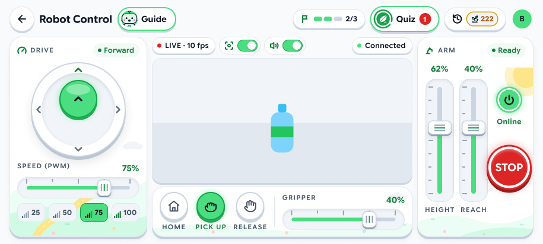
  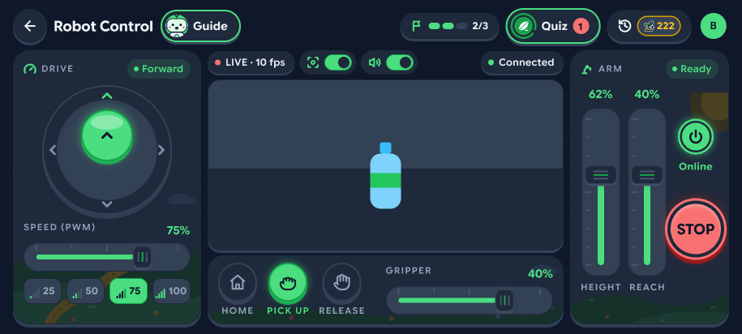
  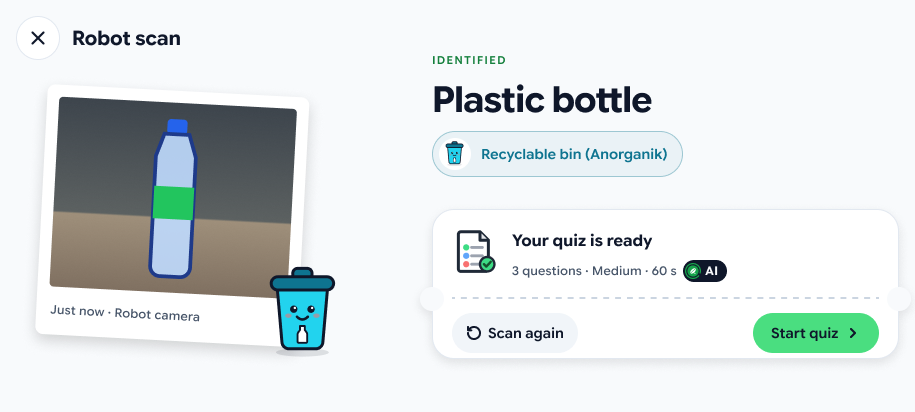
  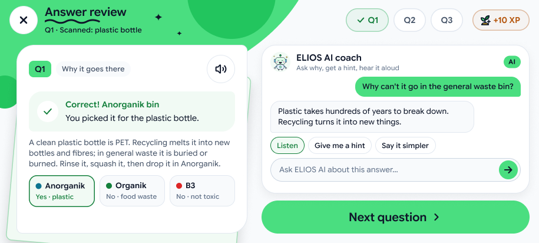
</p>

Screens are from the **ELIOS 3** page of the
[Figma file](https://www.figma.com/design/J2jSbARJSyJCStNFeWkWDj/?node-id=628-2360).
The app follows them; small differences can exist.

## Current status (19 Nov 2026)

| Area | Status |
|---|---|
| Phone scan → Gemini identify → quiz | Working on Android (tested on an Edge 60 Fusion). About 1.1–1.6 s per AI call. |
| Quiz types | Multiple choice, essay (graded by Gemini with per-criterion feedback), bin check. EN and ID. |
| Offline fallback | Working. With no internet or all Gemini models capped, questions come from the built-in question bank. |
| History, Learn hub, daily Guides, PDF export, dark mode | Working on the phone. |
| Robot driving (joystick, speed fader, STOP) | Built and tested against the fake MaixCAM2. Joystick constants not tuned on the real robot. |
| Robot arm keys (BASIS, Height, Reach, gripper, PICK, RELEASE, HOME) | App ↔ MaixCAM2 checked over USB on 19 Nov. The MaixCAM2 → ESP32 serial link is **not wired yet**, so the arm does not physically move. |
| Automatic sort (R1: lock → pick → bin → bin-tag check → drop) | Built and unit tested on the simulator. B3 bin sequence saved; organik/anorganik sequences still open. Not run on the robot. |
| Wheels | Command path exists (`motor`); wheel watchdog not built. |
| macOS build | Debug / visualisation only. Currently blocked by code signing on the owner's Mac. |

Tests: about 2,095 Flutter tests pass (20 skipped), plus firmware and fake-robot
Python tests. Known issues and next steps: [`docs/HANDOFF.md`](docs/HANDOFF.md).

## How it works

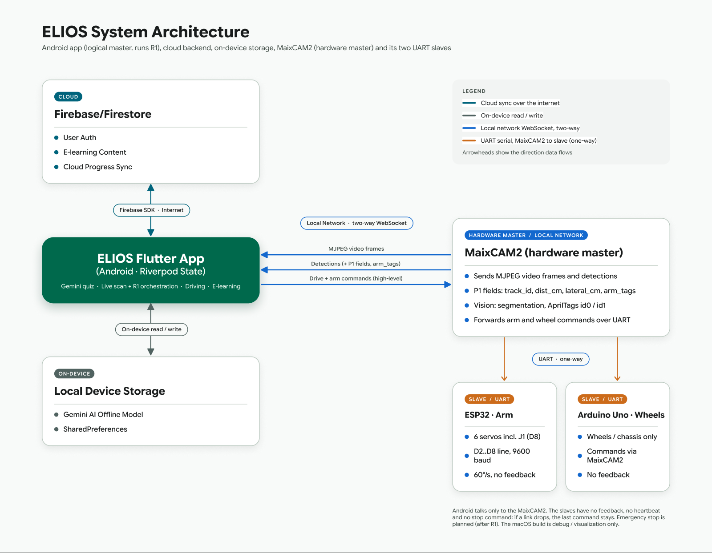

- **Flutter app** (Android first, Riverpod): scan, quiz, history, learning, and
  the robot's "brain" (the R1 sort state machine).
- **ai-backend** (Vercel, Singapore): holds the Gemini key, checks the
  student's Firebase sign-in, and tries a chain of Gemini models.
- **Firebase**: sign-in, learning content, progress sync.
- **MaixCAM2** (robot camera, hardware master): streams video, tracks the
  locked item, reads AprilTags, and forwards arm and wheel commands over UART.
- **ESP32** drives the 6 arm servos; **Arduino Uno** drives the wheels.

## Gemini: object detection and quiz generation

All AI calls go through `lib/services/ai_quiz_service.dart` → `ai-backend/api/ai.js`.

**Identifying the item (object detection)**

1. Phone: the student takes a photo. Robot: the student taps **LOCK** (or
   **SCAN**) on the control screen.
2. The app sends a 512 px JPEG to Gemini. Gemini returns the item name, its
   category, a hazard flag, and (on the robot) the item's box in the frame.
3. On the robot, the app sends that box to the MaixCAM2 (`track_start`). The
   MaixCAM2 then follows the item on-device with the MixFormerV2 tracker, so
   Gemini is asked once per item, not every frame (decisions
   [0181](docs/decisions/0181-lock-button-ai-box.md),
   [0182](docs/decisions/0182-camera-tracks-lock-box.md)).
4. Bin choice: a hazardous item always goes to **B3**; non-hazardous residu
   goes to anorganik ([0012](docs/decisions/0012-crop-identification-and-hazards.md)).

**Generating the quiz**

- After identify, Gemini writes the questions about that item (each reply has
  an Indonesian and an English version), grades essay answers, writes the
  explanations, and answers the coach chat.
- The difficulty, essay on/off and language come from the student's settings.

**Model chain and limits** (`ai-backend/chain.js`, decision
[0179](docs/decisions/0179-gemini-cloud-ai.md)):

`gemini-3.5-flash-lite` → `gemini-3.1-flash-lite` → `gemini-3-flash-preview`
→ `gemini-3.6-flash` → `gemini-robotics-er-2-preview`

A model that hits a rate limit, times out (8 s) or errors is skipped and the
next one is tried. If all fail, the app uses the question bank and tells the
student. The backend currently uses a **free-tier key**; move to a paid key
before real students use it (on the free tier Google may use prompts and photos).

## Controlling the robot

1. Turn on the robot and join the phone to the **ELIOS** Wi-Fi.
2. In the app: **Scan → Robot scan → Select vehicle → ELIOS**, then **Connect**.
   The app talks only to the MaixCAM2, over a WebSocket on port 8765.
3. On the control screen (phone in landscape):

| Control | What it does |
|---|---|
| **Drive joystick** (left) | Drives the wheels. The **speed (PWM)** fader sets the top speed. |
| **LOCK** | Asks Gemini what the item in view is and starts tracking it. |
| **SCAN** | Identifies the item and opens the quiz. |
| **STOP** (red, always visible) | Stops the arm and abandons the running command. Also on every quiz page. |
| **Height / Reach** faders, **BASIS** joystick (right) | Move the arm. Moves are planned in the app (inverse kinematics, joint limits, keep clear of the tank); refused moves show a message. |
| **Gripper** fader, **PICK**, **RELEASE** | Close / open the gripper. |
| **HOME** | Returns the arm to its safe home pose. |
| **Guide** / **Advanced** | Help, and robot settings (joystick feel, servo trims, PIN-protected). |

**Automatic sort (R1):** after a robot scan, the student answers a bin-check
question, then the robot picks the item, drives the arm to the bin, checks the
bin's AprilTag (id 2 anorganik, 3 organik, 4 B3) and only then drops it. A
wrong or missing tag stops the sort and sends the arm HOME. Hands in view
pause the arm.

<p align="center">
  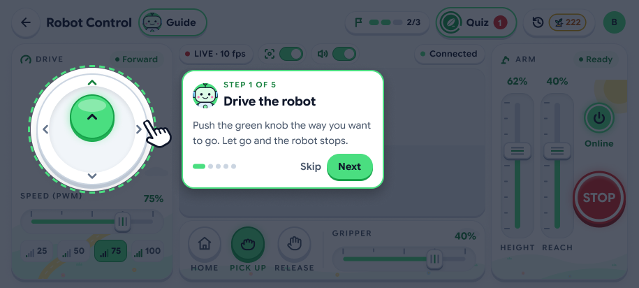
  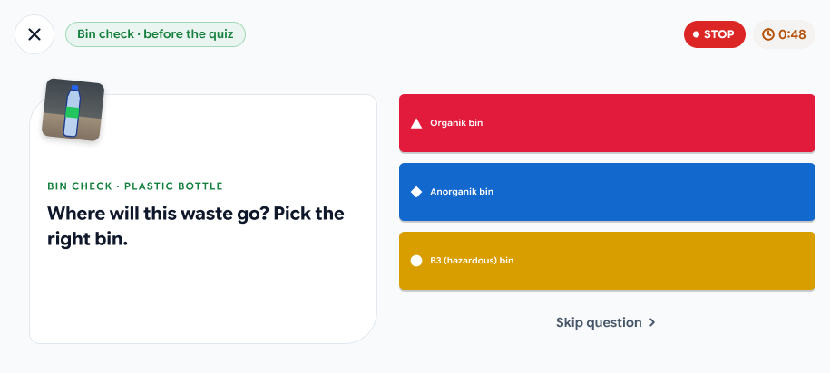
</p>

Protocol and safety details: decisions
[0023](docs/decisions/0023-r1-command-link.md),
[0230](docs/decisions/0230-sync-robotic-hand-sim.md),
[0235](docs/decisions/0235-maixcam2-arm-bridge.md). Firmware:
[`firmware/maixcam2/README.md`](firmware/maixcam2/README.md).

## How to run

### Requirements

- Flutter stable (Dart ≥ 3.11), Android Studio / Android SDK (Android 11+,
  `minSdk` 30), Xcode for macOS/iOS.
- Firebase config files (see below).
- Nothing else for AI: the app uses the hosted backend by default.

### Android phone (main target)

```bash
git config core.hooksPath .githooks
```

```bash
flutter pub get
```

```bash
flutter run -d <your-phone-id> --dart-define=LIVE_SCAN=true
```

Build flags (`--dart-define=...`):

| Flag | Meaning |
|---|---|
| `LIVE_SCAN=true` | Turns on the robot live scan and control screen. |
| `TESTER_BUILD=true` | Shows tester switches (question source, etc.). |
| `DARK_MODE_OPTION=true` | Shows the dark-mode setting. |
| `ELIO_ENV=dev\|prod` | Picks the Firebase environment (default `dev`). |
| `ELIOS_AI_URL=...` | Points the app at another AI backend. |
| `APP_COMMIT=$(git rev-parse --short HEAD)` | Shows the build's commit in the app. |

### macOS (debug, for the robot from a laptop)

Use a build plus `open`, not `flutter run` from the IDE (that breaks the Local
Network permission):

```bash
flutter build macos --debug --dart-define=LIVE_SCAN=true --dart-define=APP_COMMIT=$(git rev-parse --short HEAD)
```

```bash
open build/macos/Build/Products/Debug/ELIOS.app
```

### Without a robot: fake MaixCAM2

`tools/fake_maixcam/` plays a robot on your computer (video, detections, arm
motion from the robotic hand simulator). Setup in
[`tools/fake_maixcam/README.md`](tools/fake_maixcam/README.md), then:

```bash
~/.venvs/fake-maixcam/bin/python tools/fake_maixcam/fake_maixcam.py --sim-path ~/GITHUB/ELIO/robotic_hand_sim --scenario tools/fake_maixcam/scenarios/single_item_60s.yaml
```

Point the app's robot address at your computer's IP (port 8765).

### AI backend (only if you deploy your own)

```bash
cd ai-backend && npx vercel env add GEMINI_API_KEY production && npx vercel deploy --prod
```

The key is set in Vercel only; never commit it.

### Tests

```bash
flutter analyze
```

```bash
flutter test
```

```bash
scripts/check-secrets.sh
```

## Firebase setup

Real Firebase config files hold API keys and are **never committed**. They are
listed in `.gitignore`. Each developer downloads their own copies.

| File | Used by | How to get it |
|---|---|---|
| `.env.dev`, `.env.prod` | Web, Android fallback | Copy `.env.example` and fill in the values from Firebase console → Project settings → Your apps → Web app → SDK setup and configuration |
| `.env.android.dev`, `.env.android.prod` | Android | Same as above, using the Android app values |
| `android/app/google-services.json` | Android Gradle plugin | Firebase console → Project settings → Your apps → Android app (`com.boris.elio`) → download `google-services.json`. Template: `android/app/google-services.json.example` |
| `ios/Runner/GoogleService-Info.plist` | iOS | Firebase console → Your apps → iOS app (`com.boris.elio`) → download `GoogleService-Info.plist` |
| `macos/Runner/GoogleService-Info.plist` | macOS | Same file as iOS, copied into `macos/Runner/` |
| `lib/firebase_options.dart` | Not used today | Only if you run `flutterfire configure`. Template: `lib/firebase_options.dart.example` |

Missing required keys fail fast at startup with a clear error. The pre-push
hook runs `scripts/check-secrets.sh`.

## Plan and design

- Plan and milestones: [Notion: ELIOS](https://app.notion.com/p/ELIOS-3f29675ed4f3800abef3fbb7daefe405)
- Architecture, ERD and pipeline charts: [Figma board, node 74:130](https://www.figma.com/design/J2jSbARJSyJCStNFeWkWDj/?node-id=74-130), mapped in [`docs/pipeline/README.md`](docs/pipeline/README.md)
- Decisions: [`docs/decisions/`](docs/decisions/) · Changes: [`CHANGELOG.md`](CHANGELOG.md) · Hand-off: [`docs/HANDOFF.md`](docs/HANDOFF.md)
